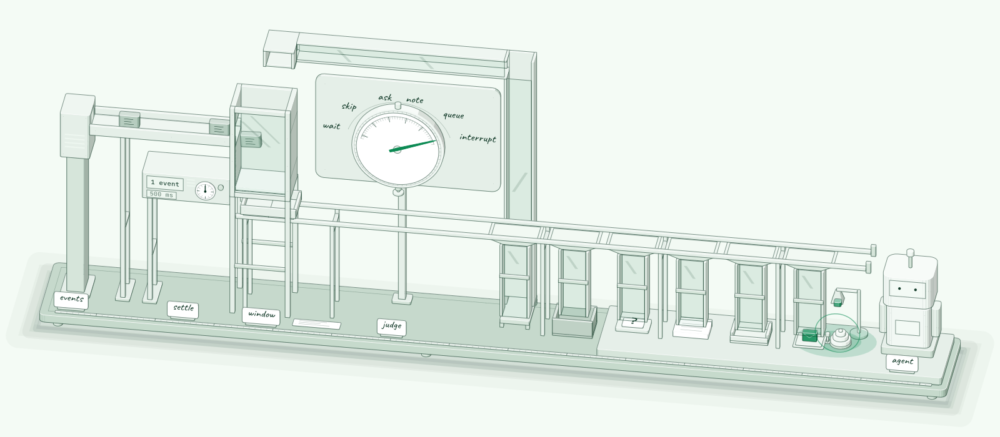
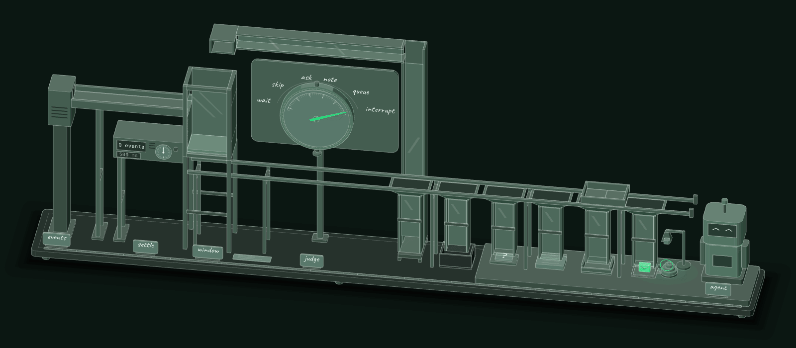

<p align="center">
  
</p>

<h1 align="center">attend</h1>

<p align="center">Decide when an event should wake your agent.</p>

<p align="center">
  <a href="https://www.npmjs.com/package/@acquiredintelligence/attend"></a>
  <a href="https://github.com/acquiredintelligence/attend/actions/workflows/ci.yml"></a>
  <a href="LICENSE"></a>
  
</p>

<p align="center">
  <a href="#see-it-decide">Demo</a> ·
  <a href="docs/how-it-works.md">How it works</a> ·
  <a href="#read-the-docs">Docs</a> ·
  <a href="skills/attend/SKILL.md">Agent skill</a>
</p>

Picture an agent that watches your app. The app never stops talking: log lines, messages, clicks, alerts. Wake the agent on every event and it never finishes a thought. Put it behind a debounce and it sleeps through the one message that mattered.

attend holds each scope's events until they add up to something, asks a judge what the agent should do, and hands your app one decision. Your app keeps the final say in how that decision runs. In the sample below, a failed build waits, and the user's question wakes the agent with both.

```ts
import { createAttend, defaultNotice } from '@acquiredintelligence/attend';

const attend = createAttend({
  kind: { 'user.message': 'flush', 'build.failed': 'closing' },
  judge: async ({ window }) => ({ route: window.reason === 'flush' ? 'interrupt' : 'note' }),
  sink: (decision) => console.log(`[${decision.route}]\n${defaultNotice(decision)}`),
});

void attend.run();
await attend.push('session-1', { name: 'build.failed', text: 'Build 4521 failed: 1 test' });
await attend.push('session-1', { name: 'user.message', text: 'can you look?' });
```

The build failure alone never wakes the agent. The user's message settles the window at once, and the agent hears both lines in one notice:

```text
[interrupt]
Build 4521 failed: 1 test
can you look?
Attend to this now, even mid-task.
```

## Install

```sh
npm install @acquiredintelligence/attend
```

attend needs Node 22.13 or later and ships ESM only. The engine has no runtime dependencies. Before production, replace the function judge with [a real judge](docs/judges.md) and pass `store` [a database store](docs/storage.md); without one, state lives in memory.

## See it decide

In a clone of this repo, `pnpm demo` streams a short CI story from a real MCP Events server into attend and prints what the agent hears. It needs no API key and no database. The source is [`examples/demo.ts`](examples/demo.ts).

```text
attend demo: a CI server streams MCP Events, and attend decides what the agent hears.

 0.0s  event    ci.started {"run":4521,"branch":"main"}
 0.1s  event    ci.log {"line":"pnpm install"}
 0.2s  event    ci.log {"line":"pnpm test"}
 0.3s  event    ci.log {"line":"211 passed, 1 failed"}
 0.4s  event    ci.test_failed {"test":"checkout applies the coupon"}
 0.6s  settle   5 events (closing)
 0.6s  judge    wait (hold the window and judge it again)
 1.0s  event    comment.created {"author":"sam","body":"can you look?"}
 1.0s  settle   6 events (flush), merged with the held window
 1.0s  judge    interrupt
 1.0s  deliver  interrupt
                ci.started {"run":4521,"branch":"main"}
                ci.log {"line":"pnpm install"}
                ci.log {"line":"pnpm test"}
                ci.log {"line":"211 passed, 1 failed"}
                ci.test_failed {"test":"checkout applies the coupon"}
                comment.created {"author":"sam","body":"can you look?"}
                Attend to this now, even mid-task.
 1.8s  event    deploy.finished {"env":"staging","sha":"9f3c2e1"}
 2.0s  settle   1 event (closing)
 2.0s  judge    note
 2.0s  deliver  note
                deploy.finished {"env":"staging","sha":"9f3c2e1"}
                Background only. No reply is needed.

7 events in, 2 deliveries out. Waking on every event would have run the agent 7 times.
```

attend held the log lines until the failed test closed the window. The judge chose `wait`, so the user's comment joined the held window, and one interrupt carried all six events to the agent. The deploy arrived as a `note`.

## What you get

- **6 routes.** The judge picks `interrupt`, `queue`, `note`, `ask`, `wait` or `skip`, and your app carries it out.
- **Windows that settle when an act ends.** A finished build or a message to the agent settles the window. A log line never wakes the agent on its own.
- **Your choice of judge.** TypeSafe's Jev, the OpenAI Decisions API, any model through `llmJudge`, or a plain function.
- **4 stores.** Memory, SQLite, Postgres and Redis, each crash-tested at every commit boundary in CI.
- **At-least-once delivery.** A decision keeps its id across retries, so your sink can drop repeats.
- **0 runtime dependencies** when embedded, or one command to serve decisions over MCP Events.

## How it works

<picture>
  <source media="(prefers-color-scheme: dark)" srcset="docs/assets/how-it-works-dark.svg">
  
</picture>

<details>
<summary>Watch it run</summary>
<br>

</details>

The judge picks the route, and your app carries it out. `interrupt` means the agent should hear this now, and your handler decides whether that cancels the turn, steers it or shows a banner. Raw events never leave attend. Only settled, judged decisions do. [How attend works](docs/how-it-works.md) walks through each step, and [the reference](docs/reference.md) lists every kind, route and default.

## Run it in your process or beside it

| | Embedded | `attend serve` |
|---|---|---|
| What | `createAttend` in your process | The same engine as a process of its own: a sidecar next to your app |
| Events in | `attend.push(scope, events)` | `POST /v1/ingest` with NDJSON, from any language |
| Decisions out | Your `sink`, called in-process | MCP Events: `events/poll`, `events/stream`, and the `attend_wait` and `attend_window` tools |
| Use it for | **Real-time agents.** The default. Flush to delivery stays in-process, with no network hop. | Apps that are not TypeScript, several agents on one firehose, or a team that wants one shared attention service |

To run the sidecar, see [Run attend as a sidecar with attend serve](docs/serve.md).

## Read the docs

| Page | Read it to |
|---|---|
| [How attend works](docs/how-it-works.md) | understand scopes, windows, settling and the decision log |
| [Reference](docs/reference.md) | look up kinds, routes, guarantees and defaults |
| [Choose a judge](docs/judges.md) | pick and configure Jev, the Decisions API, `llmJudge` or your own, and set the window budget and the act threshold |
| [Deliver decisions to your agent](docs/sinks.md) | write an idempotent sink and a dead-letter handler |
| [Choose a store](docs/storage.md) | run on memory, SQLite, Postgres or Redis, and share a store between processes |
| [Give a Mastra agent attention](docs/mastra.md) | wire attend in front of a Mastra agent with one sink |
| [Feed attend from an MCP Events server](docs/mcp-events.md) | subscribe a scope to an MCP Events stream with `mcpEventsSource` |
| [Run attend as a sidecar](docs/serve.md) | send events over HTTP and subscribe agents over MCP |
| [attend serve reference](docs/serve-reference.md) | look up every flag and the ingest wire format |
| [Test with a fake clock](docs/testing.md) | make settling deterministic in your tests |
| [Write a store adapter](docs/adapters.md) | implement `ScopeStore` and run the conformance and crash suites |

## Let your coding agent wire it in

The repo ships an [Agent Skill](skills/attend/SKILL.md) that leads your coding agent through wiring attend into your app. It works out which events the app emits, which of them are signals, and which deserve which reaction. It tells you in a few lines what it will do, asks one batch of questions with a recommended default for each, and wires it in with one small module and a few call sites at your existing event chokepoints. To install it in Claude Code:

```text
/plugin marketplace add acquiredintelligence/attend
/plugin install attend@attend
```

For Codex or Cursor, copy `skills/attend` into your project's `.agents/skills/`. The npm package includes the skill at `node_modules/@acquiredintelligence/attend/skills/attend`. The third-party Vercel Labs CLI also installs it with `npx skills add acquiredintelligence/attend`. That CLI is not part of this project.

## Status

attend is v0, and its API can change before 1.0. MCP Events is a working-group draft, so its wire shapes can change too. `@acquiredintelligence/attend/mcp` follows the current draft.

## License

MIT. Built by the team behind [Zettel](https://zettel.study).
